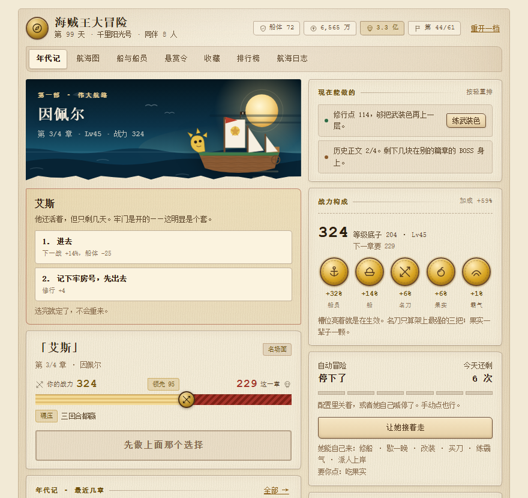
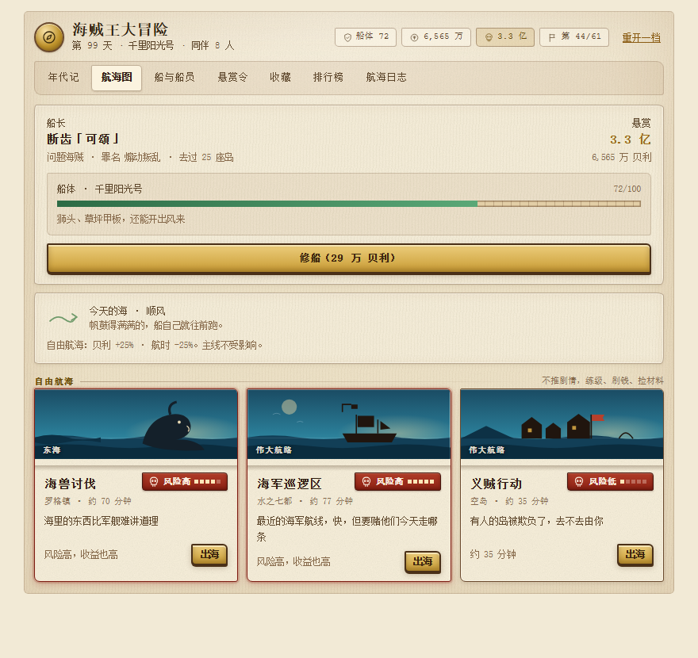
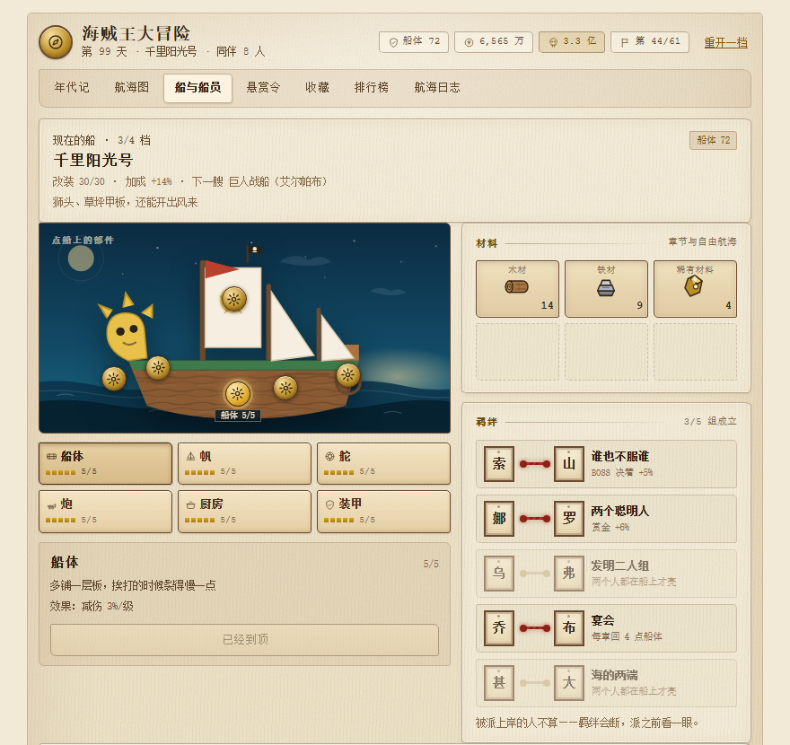
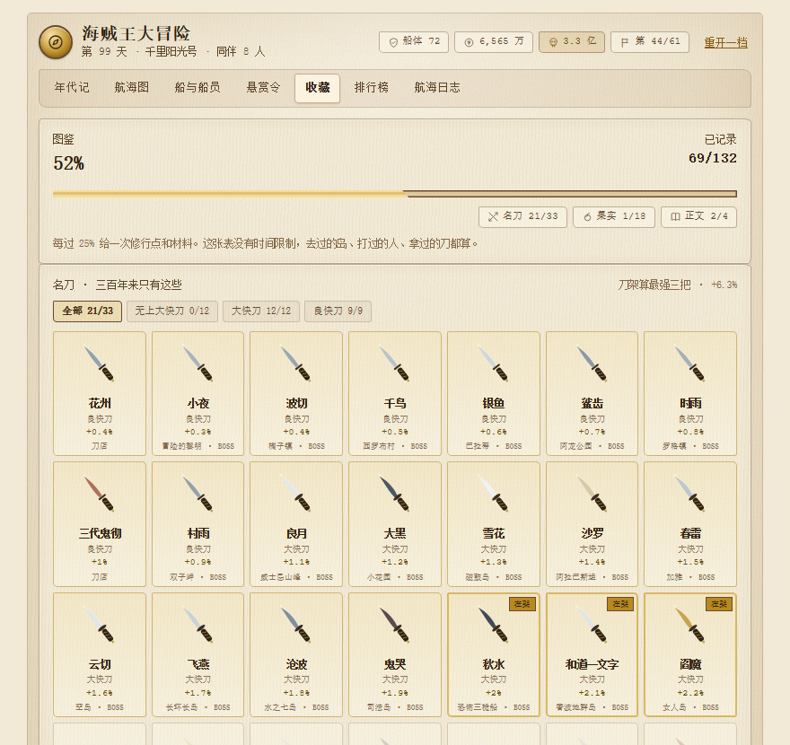

# 海贼王大冒险 · cortico-world-onepiece

给 [Coopanion](https://github.com/Pal-AI-Lab/Coopanion) 桌宠的一个「剧情世界」：**30 篇 119 章的连载**，她一章一章往前打，打不过就自己练级——你不在的时候她也在走。

不联网、不额外调用模型、所有结算在本机按规则算。面板是复古羊皮纸风，纸纹、铅字、印章、铜齿轮全是浏览器里现算的 SVG 和 CSS，一张图片都没引。



## 她能做什么

- **119 章剧情**，从风车村到拉夫德鲁。每章四种节点（航行 / 交涉 / 遭遇 / 名场面），五种结果（碾压 / 胜 / 惨胜 / 败走 / 被俘），败走和被俘都不清进度
- **BOSS 三回合**：赢两回合才算过，七道「门」额外 ×1.5
- **十个同伴**按剧情上船，各有被动；会累，累了只剩七成力；可以派上岸办三章的事
- **船坞**六个部件，用木材、铁材、稀有材料和贝利升级；船本身跟着剧情换四档
- **收藏**：33 把名刀（一个篇章一把，刀架只算最强三把）、18 颗恶魔果实（一辈子一颗）、3 种霸气、132 条图鉴
- **收尾**：四块历史正文凑齐开隐藏章；司法岛之后还有一件不可逆的事
- **她自己能动手**：修船、改装、买刀、练霸气、派人上岸——七个开关，你决定哪些让她自己办
- **每天一个海况**：顺风、无风、浓雾、涌浪，只影响自由航海，主线不看天吃饭

| 航海图 · 今天的海 | 船坞 |
|---|---|
|  |  |

| 悬赏令 | 收藏 |
|---|---|
|  |  |

## 安装

需要先装好 [Coopanion](https://github.com/Pal-AI-Lab/Coopanion)（它自己是一个 DSH 插件）。

两种装法，选一种。

**方式一：从 npm 装**（最省事）

```bash
cd <Coopanion 数据目录>/extensions
npm i cortico-world-onepiece
```

**方式二：本地链接**（想改代码就用这个）

把这个仓库克隆到任意位置，然后编辑 Coopanion 数据目录下的 `extensions/package.json`，加一条本地链接依赖：

```json
{
  "dependencies": {
    "cortico-world-onepiece": "link:/绝对路径/cortico-world-onepiece"
  }
}
```

然后在 Coopanion 里重载扩展（或直接重启应用），到设置里找到「海贼王大冒险」，打开并配置。

Node.js >= 22。包本身没有运行时依赖。

## 关于版权

这是一个**非官方、免费、非商业的同人作品**。

《ONE PIECE / 海贼王》的角色、篇章、名刀与恶魔果实设定归 **尾田荣一郎 / 集英社 / 东映动画** 所有。本项目没有获得任何授权，也不代表权利方的立场。

代码以 MIT 发布（见 [LICENSE](LICENSE)），但 **MIT 只覆盖代码，不覆盖上述原作设定**。

如果你是这个项目的权利方并希望它下线，开一个 issue，我会照办。

---

## 更新史

给 Coopanion 桌宠的剧情世界。v0.3 起它不再只是「每天挑一条航线」，而是**一部 30 篇 119 章的连载**：她一章一章往前打，打不过就自己练级，你不在的时候她也在走。

v0.4 / v0.5 把「人和船」和「收藏」补上了：十个同伴会按剧情上船，船有六个部件可以花钱改，名刀、恶魔果实、霸气、图鉴构成了另一条不花时间的成长线；BOSS 变成三回合，路上还有二十来处需要拿主意的地方。

v0.6 补的是**不可逆的那几件**：司法岛之后梅丽号会沉，四块历史正文凑齐会开出隐藏章「空白的一百年」；同伴之间有了羁绊，也可以被派上岸办事；面板顶上多了一张「现在能做的」，每一条都能直接点。

v0.12 把**作弊的口子全焊死**：不再有「走一步」「跳过等待」「立刻上岸」「点一下立刻回来」——这些按钮的共同毛病是比正常玩法更省事，摆在面板上等于把节奏作废。然后给「今天」加了一点变化：每天一个海况（顺风 / 无风 / 浓雾 / 涌浪 / 风平浪静），只影响自由航海，主线不看天吃饭。

v0.11 把**港口那几件活交到她手上**：修船、改装、买刀、吃果实、练霸气、派人上岸——之前只有面板能点，她伸不到手。现在多了一个 `sea_do` 工具，配七个授权开关：打勾的她自己就能办，没打勾的她会回一句「主人还没让我动这个」。吃果实默认关着（一辈子一颗，不可逆，这件事得你自己定）。自动挂机也接了这套授权：船半沉会先补、打不过会先改装买刀，都会看你的开关。

v0.10 是**节奏**：等级不再等于章号——升级经验加了二次项，35 章 Lv24、通关 Lv53（原来 31 / 79），自由航海一趟从 0.55 级降到 0.18 级、一天最多六趟；推完一章，船要真的开去下一个岛（普通 5~9 分钟、BOSS 9~13 分钟），面板上是个倒计时，等不及可以花钱开快点。

v0.9 是一次**数值返工**：悬赏改回「海军定价」——起手 0，只有 BOSS 章才上一份新悬赏令，阿龙 3000 万、阿拉巴斯坦 1 亿、司法岛 3 亿、和之国 30 亿、终局 50 亿，跟原作同位置对得上；普通章节在原难度上多要两成，那口气得靠名刀、改装、霸气和练级去补，不再是一路点过去。

v0.8 把整块面板换成**复古航海**的质感：羊皮纸底、深褐细描边、木牌按钮、铅字标题和打字机数字。横幅底边撕开贴到纸上，战力变成五枚铜徽章，船坞的交互点是黄铜齿轮，材料是手绘粗描边的圆木与铁锭，羁绊是两张小通缉令拴着红绳，悬赏令换成有折痕、缺墨和 15° 印章的旧纸。

v0.7 是界面重做 + 收藏扩容：面板分成两栏（左边剧情、右边养成），战力不再是 Excel 表而是五个装备槽；船坞里可以直接点船上的部件；材料变成背包格子；羁绊做成两块拼图；悬赏令换成旧纸、剪影拓印和盖章。名刀从 8 把扩到 **33 把**——无上大快刀十二工 12 把、大快刀二十一工 12 把、良快刀五十工 9 把，一个篇章一把；恶魔果实从 6 颗扩到 **18 颗**。

不联网、不和其他桌宠聊天、不额外调用模型。所有结算都在本机按规则算。

## 这一版有什么

- **剧情线**：三部 30 篇 119 章，从风车村一路到拉夫德鲁。每篇最后一章是 BOSS
- **四种节点**：航行、交涉、遭遇、名场面；其中 16 处名场面 + 7 道门的 BOSS 会停下来问你「怎么选」
- **五种结果**：碾压 / 胜 / 惨胜 / 败走 / 被俘。**败走和被俘都不清空进度**，只损船、损钱，可以再来
- **等级**：Lv1–120。战力 = 等级底子 ×（1 + 船员 + 船 + 名刀 + 果实 + 霸气）
- **船员**：索隆、乌索普、山治、娜美、乔巴、罗宾、弗兰奇、布鲁克、甚平、大和，按剧情自动上船；各带一个被动，会累，累了只剩七成力
- **船坞**：船体 / 帆 / 舵 / 炮 / 厨房 / 装甲六个部件，各 5 级，用木材、铁材、稀有材料和贝利升
- **收藏**：33 把名刀（无上大快刀十二工 12 / 大快刀二十一工 12 / 良快刀五十工 9；一个篇章一把，刀架只算最强三把）、18 颗恶魔果实（一辈子只能吃一颗，吃了怕海水）、3 种霸气（各 5 级，用修行点）、一份 132 条的图鉴
- **羁绊**：五组固定搭配（索隆+山治、娜美+罗宾、乌索普+弗兰奇、乔巴+布鲁克、甚平+大和），两个人都得在船上才成立，被派走就断
- **派遣**：把一个人放上岸办事，三章之后回来，带回材料、钱或修行点；这三章他不算战力
- **历史正文**：四块石碑分别从阿拉巴斯坦、空岛、鱼人岛、和之国的 BOSS 身上掉，凑齐 4/4 开隐藏章
- **隐藏章「空白的一百年」**：比结局那一章还硬 18%，赢了贝利 +5 亿、赏金 +50%、称号换成「知晓真相的人」；输了什么都不掉
- **BOSS 三回合**：试探 / 交锋 / 决着，三条线 90 / 96 / 104，赢两回合才算过
- **自动冒险**：到点她自己挑下一步——打得过就推剧情，打不过先自由航海练级；一天有上限，离线按时间补结算
- **自由航海**：五类航线，真实时间出海，练级刷钱捡材料
- **悬赏令**：绰号、罪名、金额、死活不论；赏金跨过 1 亿、3 亿、5 亿…… 会换新称号
- **排行榜**：60 个原作海贼，赏金用原作的数（罗杰 55.648 亿、白胡子 50.46 亿、凯多 46.111 亿……乔巴 1000）
- **年代记**：面板第一页就是进度条、下一章、最近过的几章
- **不可逆事件**：梅丽号那一页会单独占一张深色卡片，读完收起来，之后它只会出现在日志里

## 面板

七页，全部本地渲染：

| 页 | 看到什么 |
|---|---|
| 年代记 | 两栏。左：梅丽号那张纸（有的话）→ **下沿撕开的**落日海面横幅（右边那条船就是她现在的船）→ 抉择卡 → 下一章、「你的战力 / 这一章」的对决绳（中间一枚交叉双刀铜章）、BOSS 三条刻度尺、最近六章。右：**现在能做的** → 五枚**铜徽章**（船员 / 船 / 名刀 / 果实 / 霸气，空的暗着）→ 自动冒险 → 船与船员速览 |
| 航海图 | 船长卡（悬赏、贝利、船体、修船）+ 三条自由航线：上半张插画（商船 / 海兽 / 遗迹 / 军舰 / 村子），下沿撕成毛边压到羊皮纸上，右上角一块**红漆木牌**写「骷髅 + 风险高/一般/低 + 五颗星」，风险 ≥4 的整张卡描暗红边；在海上时显示倒计时 |
| 船与船员 | 带木纹的船 + 六个**黄铜齿轮**交互点（悬停放大发光，点哪个部位就升哪个）+ 六块**木牌**选项卡（各带一枚复古图标）+ 皮革背包格里的材料（圆木 / 铁锭 / 晶石，粗描边）+ **两张小通缉令用红绳拴住的**羁绊 5 组 + 十个同伴（定位、被动、疲劳条、**派上岸 / 叫回来**）+ 歇一晚 |
| 悬赏令 | 一张真正做旧的纸：三层污渍 + 纸纹 + 两道折痕 + 25 点毛边裁切；WANTED 是**带铅字毛刺**的内联 SVG 字；画像 46px 名字紧贴照片、金额上下压两道粗横线；DEAD OR ALIVE 加粗框；右上角 15° 的「懸賞」印章带墨晕和残缺；底部是海军**海鸥徽**。**不画脸**——只画剪影加网点，画不像比不画更难看 |
| 收藏 | 图鉴总览 + **33 把名刀**（按三档筛选，锁着的只有剪影和出处）+ **18 颗果实**（吃 / 卖，没见过的灰着）+ 霸气 + **历史正文 4 块**与隐藏章入口 + 132 条图鉴（岛 / 人物 / 刀 / 果实 / 名场面 / 石碑 / 事件） |
| 排行榜 | 60 个原作海贼 + 你自己，自己那行钉在顶部 |
| 航海日志 | 每条：第几天、岛与章名、结果、那个岔口选了什么、当时赏金 |

船有四档，跟着剧情位置换：小帆船 → 梅丽号（第 10 章，西罗布村）→ 千里阳光号（第 58 章，司法岛之后）→ 巨人战船（第 113 章）。档次不用买；能花钱的是六个部件。

顺带修了一个老 bug：以前船的档次只在建号时写一次，之后再也不变——面板画的是阳光号，战力算的还是小帆船。现在档次按剧情实时算，存档里那个值也会跟着同步。

## 难度：为什么会有打不过的时候

- 章节难度 = 原难度 ×「这个位置该有的加成」。船员和船的档次是白给的，所以算进预期；**名刀、果实、霸气、改装件不算**——那些是花力气赚来的余量
- 七道**门**（阿拉巴斯坦、空岛、司法岛、马林梵多、万国、和之国、拉夫德鲁）：那一章的 BOSS 额外 ×1.50
- 同一道门**硬打第二次开始变难**（每次 +8%，最多 +24%）：BOSS 会摸清你的套路。**但隔三天没去，这个加价会松掉**——不然「等级到顶 + 打不过 + 越打越难」就是个死锁
- BOSS 三回合要赢两回合，所以「过门」的实际门槛是战力 ≈ 难度 × 0.96
- 败走只给 5% 经验、还要扣钱扣船——硬推不划算。**自由航海一趟约 0.18 级（一天最多六趟）**，是过门之前绕不过去的那段路
- 实测（`npm run balance`）：只推主线不买东西，177 步、55 趟自由航海；正常玩（改装 + 买刀 + 练霸气）137 步、18 趟

## 今天的海

每天一个海况，按「存档种子 + 日期」算出来：风平浪静 / 顺风 / 浓雾 / 涌浪 / 无风。

- **顺风**：自由航海贝利 +25%、航时 -25%
- **无风**：航时 +40%、贝利 -15%
- **涌浪**：船体损伤 +30%、收益 +15%
- **浓雾**：风险 +1、贝利 -10%
- **风平浪静**：什么都不变

**只影响自由航海，主线章节一点不受影响**——剧情不该看天吃饭。同一天里读档、关掉面板再开、甚至刷新预览，都是同一个天气；换个存档种子才会变。

它给的是「今天适合干什么」：顺风天刷航线，无风天推剧情。平均算下来略偏正面（各档收益均值约 +3%），是给每天回来看看一个由头，不是惩罚。

## 没有调试入口

发布版一个都不留：没有「走一步」、没有「跳过等待」、没有一键上岸，也没有「点一下立刻回来」。这些按钮的共同毛病是**比正常玩法更省事**，摆在面板上就等于把节奏作废。

- 想快进推章：等航程走完，或者花一章收入 1.4 倍的钱点「开快点」
- 被押送了：等几分钟，靠岸自动结束
- 想重来：面板右上角「重开一档」，旧档改名留底

真要做数值验证，用 `npm run balance` 和 `npm run sim` 那套脚本——它们在跑的时候会带一个内部的 `cfg.sim` 标记，跳过等待，但那个标记不出现在配置里，玩家碰不到。

所有新加的机制都没有等待：改装、买刀、吃果实、练霸气、歇一晚，点一下当场生效。

## 安装

### 从本机目录（推荐，先试）

设置 → 高级模式 → 扩展 → **手动安装** → **从本机目录安装** → 选中这个文件夹 → **重启进程** → 到 World 总览启用「海贼王大冒险」。

本包零运行时依赖，本机目录的 link 方式不需要额外 `pnpm install`。

### 从 npm（发布之后）

```bash
# 在 <数据目录>/extensions 下
pnpm add cortico-world-onepiece
```

装完同样要重启进程。

## 配置

| 配置项 | 默认 | 说明 |
|---|---|---|
| 用哪套名词 | 海贼王大冒险 | 另一套是「无风带」原创皮，规则和数值完全一样 |
| 她自己去冒险 | 开 | 到点她自己走；关掉就完全手动 |
| 多久走一次 | 30 分钟 | 挂机节奏；一天的上限用完就停到第二天 |
| 一天最多几次 | 6 | 119 章按这个速度约二十天走完 |
| 什么时候叫她说话 | 只在要紧的事 | 静默只写日志（0 token）；「每次都说」一天约 8 千 token |
| 一条自由航海多久 | 90 分钟 | 想马上看结果先填 1 |
| 海域有多凶 | 普通 | 平静降一档风险；凶险更容易被俘，但成功时赏金更高 |
| 榜上最多多少人 | 60 | 调小按赏金均匀抽；改完点排行榜页「重排榜单」 |
| 悬赏令上画不画脸 | 不画 | 默认是一张干净的通缉令；切成「剪影」会是深色版画风 |
| 让她自己修船 / 歇一晚 / 改装 / 买刀 / 练霸气 / 派人上岸 | 全开 | 打勾的她自己就能办；买刀有六成现钱上限、一天一把 |
| 让她自己吃果实 | **关** | 一辈子一颗、吃错换不回来，这件事留给你 |

## 为什么省 token

自动冒险默认**静默**：普通航次只写日志，不叫她。真正需要模型的只有两件事：

1. 过了章节 / 打赢 BOSS / 升级 / 被俘 / 停在岔路口——推一条 20 字事实（约 22 token）
2. 悬赏令换榜

实测常驻开销（`node scripts/token-cost.mjs`）：

| 项 | 字 | 约 token |
|---|---|---|
| 环境提示词 | 177 | 94 |
| 四个工具的 schema | 1853 | 723 |
| 一行状态 | 46 | 19 |
| 一条推送事实 | 50 | 22 |

也就是**每次请求固定约 817 token**，一条事件 22 token。一天按 6 次自动、3 次开口算，一天 2.5 千 token 左右——挂机不烧钱，说话才烧钱。真正贵的是普通聊天，不是这个插件。

v0.11 加了第四个工具 `sea_do`（修船 / 改装 / 买刀 / 吃果实 / 练霸气 / 派人上岸），一次性多 200 token/次。这四件事合在一个工具里、用一个 enum 分开，比开四个工具省将近 400 token——**没有为了省这点钱把功能砍掉，是合成一个的代价**。

v0.4 / v0.5 加了船员、船坞、收藏、三回合 BOSS、抉择，v0.6 又加了历史正文、隐藏章、羁绊、派遣、建议卡，v0.7 重做了整个面板并把名刀扩到 33 把、果实扩到 18 颗，**始终没有加工具、没有加常驻提示词**：这些全在面板里点和算，模型只有在被问起时用 `sea_status` 看一眼（状态行多了「历史正文 x/4」和「几个人在岸上」这两截）。

界面再花哨也不会推高 token：纸纹、铅字、印章、齿轮、木纹全是浏览器里现算的 SVG/CSS，一个外部字体、一张图片都没引，来回传的只有 `ctx.invoke('state')` 这一份本地数据，不进模型上下文。

隐藏章和梅丽号这类事会**额外推一条**（约 40 token），但一辈子只发生几次。

## 数据与隐私

- 存档只有一个文件：`<数据目录>/onepiece.json`
- 不联网、不上传任何东西、不读屏幕、不读其他应用
- 名字用的是部署里的 bot 名，没有就写「无名船长」
- 想重开：删掉 `onepiece.json`，下次启动就是新档（旧档想留就先改名）
- 老档会自动升级到 v6：天数、赏金、日志、榜单全保留；船员按进度补齐，打过的 BOSS 掉过的刀补进刀架，四块石碑按进度补齐（打过的 BOSS 掉过的东西就该在），梅丽号按同一个尺子算——过了司法岛就已经沉了，不再补演一遍；材料、改装、霸气、修行点从零开始

## 换皮

所有专有名词都在 `src/theme/` 下，剧情线在 `src/campaign.js`，船员在 `src/crew.js`，船与部件在 `src/ship.js`，收藏在 `src/gear.js`，岔路口在 `src/choices.js`。规则层不认识任何一个具体名词。

**关于版权**：《海贼王》及相关名词属于原作权利方。自己玩没问题；如果公开发布到 npm 或做公开榜单，建议把默认主题改成 `original`，剧情也换成原创岛屿——结构（篇章 / BOSS / 悬赏 / 船员）本身不受版权保护。

## 还没做

- 二期：全球榜、和其他桌宠互相通缉（一期存档结构已经留好位置）
- 船员合体技的「招式」：现在羁绊只给数值，还没有可以主动放的技能
- 船的可视化只做到四档，部件等级还没画到船身上

## 开发

```bash
npm test          # 契约 + 119 章全通 + 自动冒险 + 60 趟数值模拟 + 存档升级 + 剧情事件/派遣/隐藏章
npm run balance   # 三种玩家画像各跑一遍，看要多少步、多少次自由航海
npm run describe  # 改了工具声明后重新生成 describe.json
```

模块分工：`campaign`（剧情与经验）、`collect`（战力与加成）、`battle`（单场 / 三回合 / 抉择 / 掉落 / 隐藏章）、`codex`（图鉴）、`story`（历史正文 / 梅丽号 / 隐藏章数据）、`dispatch`（派遣）、`crew` / `ship` / `gear` / `choices` / `bonds`（纯数据）、`world`（存档、工具、面板数据）。

依赖是单向的，别绕圈：`rng` → 纯数据 → `collect` → `campaign` → `battle` / `story` / `codex` → `state` → `world`。`battle` 里 `resolveChapter` 是唯一「把一章写进存档」的地方，新机制都从那里挂。

## 许可

MIT。非官方扩展，与 Coopanion / Cortico 的作者无关。
